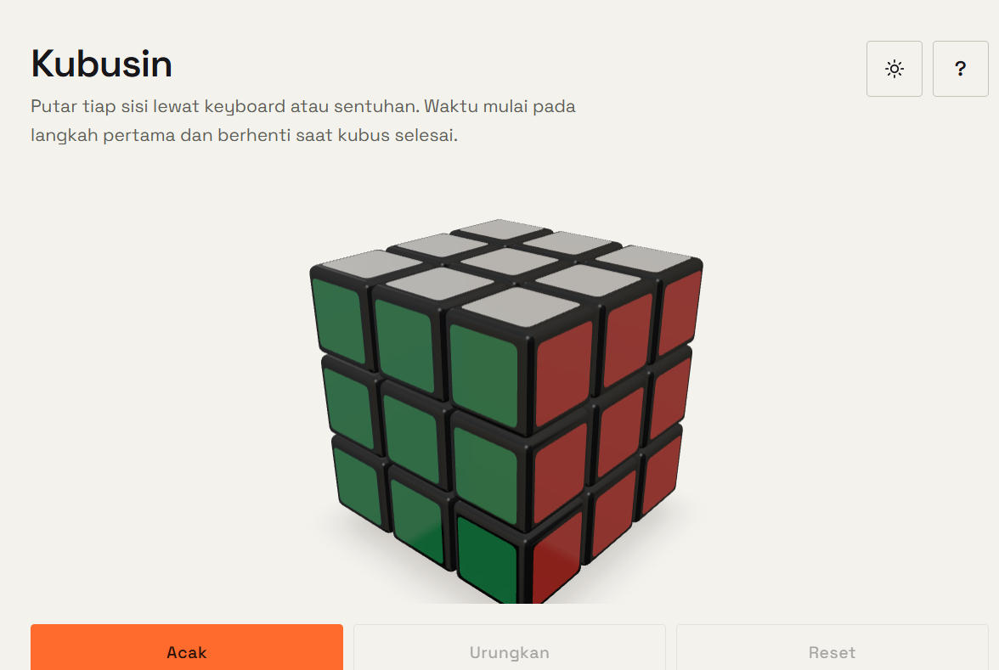
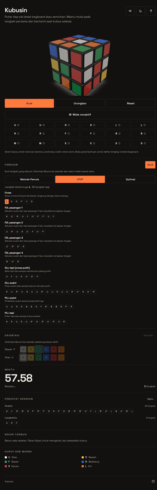

# Kubusin

Kubus Rubik 3D di browser. Putar tiap sisi lewat keyboard atau sentuhan, acak
kubus, ukur waktu, dan simpan sepuluh rekor terbaik.



Next.js (App Router) + TypeScript strict + Tailwind CSS + three.js
(`@react-three/fiber`, `@react-three/drei`) + Zustand.

## Menjalankan

Butuh Node.js 20+ dan pnpm.

```bash
pnpm install
pnpm dev        # http://localhost:3000

pnpm build      # build produksi
pnpm start      # jalankan hasil build
pnpm lint       # ESLint
pnpm test       # unit test (Vitest)
```

## Kontrol

| Tombol | Aksi |
| --- | --- |
| `U` `D` `L` `R` `F` `B` | Putar sisi searah jarum jam |
| `Shift` + huruf | Putar sisi berlawanan arah |
| `M` `E` `S` | Putar lapisan tengah (ikut `L`, `D`, `F`) |
| `W` | Aktifkan wide moves (sisi + lapisan tengah, `Rw` ...) |
| `x` `y` `z` | Putar seluruh kubus (arah `R`, `U`, `F`) |
| `←` `↑` `→` `↓` | Putar kamera |
| `Spasi` | Acak kubus (20–25 langkah) dan mulai sesi |
| `Backspace` | Urungkan langkah terakhir |
| `Enter` | Reset, dengan dialog konfirmasi |
| `?` | Buka atau tutup panel bantuan |

Mouse dan sentuhan: seret untuk memutar kamera, scroll/cubit untuk zoom. Tombol
di layar (`Acak`, `Urungkan`, `Reset`, toggle `W`, tombol arah, tombol slice)
melakukan hal yang sama. Tombol tema di header berganti terang/gelap, dan tombol
pengeras suara menyalakan atau mematikan efek suara.

## Orientasi

Panel **Orientasi** memilih warna mana yang dianggap depan (`F`) dan atas (`U`);
tombol `U` `D` `L` `R` `F` `B` ikut memutar sisi fisik yang sesuai. Ini hanya
mengubah cara memegang kubus, bukan keadaannya. Hanya `x` `y` `z` dan panel
Orientasi yang mengubah orientasi; slice dan wide tidak.

Rekor hanya dicatat kalau sesi dimulai dengan `Spasi`. Input keyboard diabaikan
selama ada modal terbuka.

## Panduan

Panel **Panduan** menampilkan langkah penyelesaian bertahap untuk susunan saat
ini dan menyorot langkah berikutnya. Saat panduan dinyalakan, kamu memilih satu
dari tiga metode:

- **Metode Pemula** — lapis demi lapis: cross bawah, sudut bawah, lapis tengah,
  lalu cross atas, orientasi sudut, susun sudut, dan susun tepi.
- **CFOP** — Cross, F2L (empat pasangan sudut-tepi sekaligus), lalu OLL dan PLL.
  F2L memakai pencarian reduced-state dengan kosakata langkah yang dibuat otomatis
  dari sekuens pendek yang tidak merusak cross atau pasangan yang sudah selesai.
- **Optimal** — penyelesaian terpendek dari `rubik-solver`, dimuat dinamis hanya
  saat metode ini dipilih.

Panduan dihitung ulang setiap kali kubus berubah, jadi selalu cocok dengan yang
tampil di layar. Rencana tahap maupun solusi optimal disimpan dengan kursor:
langkah berikutnya disorot dan sisanya berkurang selama kamu mengikutinya, dan
baru dihitung ulang kalau kubus keluar dari jalur yang diprediksi (atau kamu
menekan **Hitung ulang** pada metode optimal).

Saat panduan aktif, orientasi dikunci ke standar dan waktu tidak masuk rekor.
Pilihan metode disimpan di perangkat.

## Pencatat gerakan

Panel **Pencatat gerakan** mencatat notasi langkah untuk analisis: urutan
acakan (saat sistem mengacak) dan setiap langkah yang kamu putar, berurutan.
Undo tercatat sebagai langkah kebalikannya, karena itulah yang benar-benar
terjadi pada kubus. Tombol **Salin** menyalin keduanya sebagai teks.

## Efek suara

Setiap putaran sisi berbunyi klik pendek, dan kubus yang selesai memainkan
nada naik singkat. Suara disintesis di browser lewat Web Audio API, jadi tidak
ada berkas audio yang diunduh. Tombol pengeras suara di header mematikan atau
menyalakan suara, dan pilihannya disimpan di perangkat.

## Tangkapan layar

Tema gelap dengan panduan penyelesaian bertahap, orientasi terkunci, statistik
waktu, dan pencatat gerakan:



## Struktur

```
app/                     layout, halaman, 404, ikon, gambar Open Graph
components/cube/         rendering 3D (Canvas, cubie, animasi layer)
components/ui/           tombol, statistik, rekor, orientasi, panduan, pencatat, bantuan, overlay
components/GameShell.tsx penyusun UI + penghubung store dan keyboard
docs/                    tangkapan layar untuk README
hooks/                   useKeyboard, useElapsed, useMediaQuery, useTheme, useCubeSound
lib/cube.ts              model kubus murni (tanpa three.js), 27 cubie
lib/stages.ts            mesin pencari tahap generik (reduced-state BFS)
lib/beginner.ts          solver metode pemula, tujuh tahap
lib/cfop.ts              solver CFOP (cross, F2L, OLL, PLL)
lib/facelets.ts          cubie -> string facelet standar URFDLB
lib/optimal.ts           solusi optimal via rubik-solver
lib/guide.ts             pembanding keadaan kubus untuk kursor panduan
lib/sound.ts             efek suara sintetis via Web Audio API
store/game.ts            state permainan (langkah, antrean, timer, rekor, acakan, riwayat)
```

Logika kubus terpisah dari tampilan dan diuji langsung di Node.

## Test

`pnpm test` menjalankan 83 tes: `lib/cube.test.ts` (model kubus: langkah,
slice, wide, orientasi, acak, deteksi selesai), `store/game.test.ts` (alur
sesi, antrean, undo, gating rekor, panduan, metode, pencatat gerakan, preferensi
suara), `lib/guide.test.ts` (pembanding keadaan kubus dan kursor rencana),
`lib/sound.test.ts` (efek suara aman tanpa Web Audio), dan `lib/solver.test.ts`
(solver metode pemula dan CFOP, batas antar tahap, facelet, dan solusi optimal).

## Lisensi

MIT.
